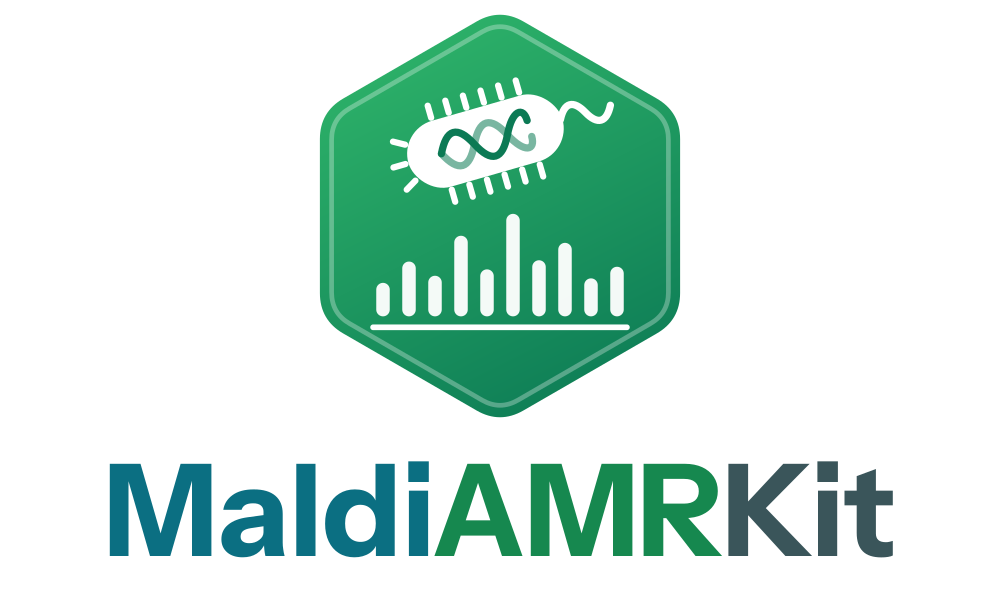

# MaldiAMRKit

[](https://github.com/EttoreRocchi/MaldiAMRKit/actions/workflows/ci.yml)
[](https://codecov.io/github/EttoreRocchi/MaldiAMRKit)
[](https://maldiamrkit.readthedocs.io/)

[](https://pypi.org/project/maldiamrkit/)
[](https://pypi.org/project/maldiamrkit/)
[](https://github.com/EttoreRocchi/MaldiAMRKit/blob/main/LICENSE)

<p align="center">
  <picture>
    <source media="(prefers-color-scheme: dark)" srcset="https://raw.githubusercontent.com/EttoreRocchi/MaldiAMRKit/main/docs/maldiamrkit_dark.png">
    
  </picture>
</p>

<p align="center">
  <strong>A comprehensive toolkit for MALDI-TOF mass spectrometry data preprocessing for antimicrobial resistance (AMR) prediction purposes</strong>
</p>

<p align="center">
  
</p>

<p align="center">
  <a href="#installation">Installation</a> •
  <a href="#features">Features</a> •
  <a href="#quick-start">Quick Start</a> •
  <a href="https://maldiamrkit.readthedocs.io/">Documentation</a> •
  <a href="#tutorials">Tutorials</a> •
  <a href="#maldisuite-ecosystem">MaldiSuite</a> •
  <a href="#contributing">Contributing</a> •
  <a href="#citing">Citing</a> •
  <a href="#license">License</a>
</p>

## Installation

```bash
pip install maldiamrkit
```

### Install the full MaldiSuite

To install MaldiAMRKit together with [MaldiBatchKit](https://github.com/EttoreRocchi/MaldiBatchKit) and [MaldiDeepKit](https://github.com/EttoreRocchi/MaldiDeepKit) at compatible versions, install the [`maldisuite`](https://pypi.org/project/maldisuite/) meta-package:

```bash
pip install maldisuite
```

Visit the **MaldiSuite** landing page at <https://ettorerocchi.github.io/MaldiSuite/>.

### Optional: UMAP & combatlearn

```bash
pip install maldiamrkit[batch]
```

MaldiAMRKit has no batch corrector of its own. This extra adds `umap-learn` for UMAP exploratory plots, and [`combatlearn`](https://github.com/EttoreRocchi/combatlearn) to use ComBat directly on a feature matrix. For batch correction built for MALDI-TOF spectra, see [MaldiBatchKit](https://github.com/EttoreRocchi/MaldiBatchKit).

### Optional: extended mzML/mzXML support

```bash
pip install maldiamrkit[formats]
```

`.mzML` and `.mzXML` files are read out of the box (zlib-compressed or uncompressed arrays). This extra installs [`pyteomics`](https://pyteomics.readthedocs.io/) with `lxml`, `psims`, and `pynumpress`, which additionally handle numpress-compressed arrays. `pynumpress` ships no wheels for Python 3.10, so numpress arrays need Python 3.11 or newer.

### Development installation

```bash
git clone https://github.com/EttoreRocchi/MaldiAMRKit.git
cd MaldiAMRKit
pip install -e .[dev]
```

## Features

### Preprocessing
- **Composable Pipeline**: Build custom `PreprocessingPipeline` from individual transformers (smoothing, baseline correction, normalisation, trimming), serialisable to JSON/YAML
- **Smoothing**: Savitzky-Golay and moving-average filters
- **Baseline Correction**: SNIP, morphological top-hat, lower-convex-hull, and iterative rolling-median baselines
- **Multiple Binning Strategies**: Uniform, proportional, adaptive, and custom bin edges
- **Quality Metrics**: SNR estimation, MAD-based noise estimation, comprehensive quality reports, and alignment assessment
- **Replicate Merging**: Mean/median/weighted merging with correlation-based outlier detection

### Alignment & detection
- **Spectral Alignment**: Shift, linear, piecewise, DTW, quadratic, cubic, and LOWESS warping for both binned and raw full-resolution spectra. Spectra are first shifted and then aligned to the reference of the shifted spectra, a non-rigid warp is kept only when the matched peaks support it, and resampling preserves the total intensity (neither applies to DTW); spectra of several species are best aligned one species at a time
- **Peak Detection**: Local maxima and persistent homology methods
- **Peak Sets**: `PeakSet` / `PeakList` represent each spectrum as a variable-length `(m/z, intensity)` set for peak-set models, via `MaldiPeakDetector.transform_peaklist()` on binned spectra or `create_peakset_input()` at full m/z resolution; extraction is stateless per spectrum, so results are cacheable without leakage
- **Fit-Free Peak Alignment**: `align_peaks()` warps a peak set onto caller-supplied reference peaks, which the caller estimates on the training split (for example `RawWarping(...).fit(X_train).ref_peaks_mz_`; a reference built with test spectra leaks)

### Extensibility
- **Component Registries**: Plug your own components into the name-dispatched machinery - `register_spectral_metric()` for distance metrics (usable in `spectral_distance`, `pairwise_distances`, and `DriftMonitor`), `register_transformer()` to make `PreprocessingPipeline` configs holding custom transformers round-trip through JSON/YAML, and `register_binning_method()` for custom bin edges
- **Discovery & Safety**: `list_spectral_metrics()`, `list_transformers()`, `list_binning_methods()` report what is registered; built-ins are replaced only with an explicit `override=True`, and unregistering an overridden built-in restores the default

### Evaluation
- **AMR Metrics**: VME, ME, sensitivity, specificity, categorical agreement, and `amr_classification_report` following EUCAST conventions
- **`mic_regression_report`**: RMSE in log2 dilutions, essential agreement (±1 dilution), and categorical agreement after re-binning to S/I/R - the regression counterpart to `amr_classification_report`
- **Stratified Splitting**: Species-drug stratified and case-based (patient-grouped) splitting to prevent data leakage
- **Group-Aware CV**: `MaldiSet.groups` / `isolate_ids()` derive per-isolate labels (DRIAMS `_MALDI<N>` replicates stripped by default, or read from a metadata column) to pass as `groups=` to splitters like `StratifiedGroupKFold`, keeping replicates of one isolate on the same side of a split

### Susceptibility (MIC encoding & breakpoints)
- **`MICEncoder`**: Convert raw MIC strings into `log2(MIC)` regression targets plus S/I/R categories and ATU flags in a single pass
- **`BreakpointTable`**: Clinical breakpoint tables (19 EUCAST versions between v1.0 and v16.0 bundled) loaded by version, year, latest, or custom YAML
- **`LabelEncoder`**: Map R/I/S to binary with configurable intermediate handling (moved from `maldiamrkit.evaluation` in v0.15)

### Differential analysis
- **`DifferentialAnalysis`**: Per-bin statistical testing (Mann-Whitney U, Welch's t-test) between resistant and susceptible groups, with multiple-testing correction, log2 fold change, and Cohen's d effect size
- **Peak Ranking**: `top_peaks()` by adjusted p-value, `significant_peaks()` with fold-change and p-value thresholds, `compare_drugs()` for multi-drug boolean significance matrices (to select features for a classifier, rank peaks inside each training fold)
- **AMR-Aware Plots**: `plot_volcano()`, `plot_manhattan()` along the m/z axis, and `plot_drug_comparison()` with binary heatmap or UpSet-style intersection view

### Drift monitoring
- **`DriftMonitor`**: Anchor a baseline on early timestamps (default: first 20%) and track temporal drift via three complementary views - reference similarity of per-window median spectra, PCA centroid trajectory in a baseline-fitted PCA space, and Jaccard stability of top-k differential peaks over time
- **Trajectory Plots**: `plot_reference_drift`, `plot_pca_drift`, `plot_peak_stability`, `plot_effect_size_drift`

### Spectral similarity
- **Distances & Clustering**: `spectral_distance` and `pairwise_distances` with built-in or registered metrics, `cluster_spectra` with hierarchical, HDBSCAN, and k-medoids methods, silhouette scores, and metadata concordance
- **Plots**: `plot_distance_heatmap` and `plot_dendrogram`

### Data management
- **Dataset Building & Loading**: `DatasetBuilder` and `DatasetLoader` with pluggable layout adapters (`FlatLayout`, `BrukerTreeLayout`, `DRIAMSLayout`, `MARISMaLayout`)
- **Replicate Collapsing**: `DRIAMSLayout(collapse_replicates=True)` merges technical replicates (`_MALDI<N>`) to one row per isolate at load time via the active `duplicate_strategy`
- **Bruker Format Support**: Read Bruker flexAnalysis binary data (fid/1r + acqus) natively via `read_spectrum()` on directories
- **Open Formats**: Read `.mzML` and `.mzXML` files (optionally gzipped) via `read_spectrum()`, `MaldiSpectrum`, and `FlatLayout(spectrum_ext=".mzML")`; `pip install maldiamrkit[formats]` adds `pyteomics` for numpress-compressed arrays
- **MIC Parsing**: `parse_mic_column()` for parsing MIC strings with qualifiers and European decimals
- **Composable Filters**: `SpeciesFilter`, `DrugFilter`, `QualityFilter`, `MetadataFilter` combinable with `&`/`|`/`~` operators
- **Spectrum Export**: Save spectra to CSV, TXT, or mzML via `MaldiSpectrum.save()` and `MaldiSet.save_spectra()`

### Visualisation & tools
- **Exploratory Plots**: PCA, t-SNE, and UMAP scatter plots coloured by species, resistance phenotype, or any metadata column
- **Batch Effect Correction**: Not part of this package. Use [`combatlearn`](https://github.com/EttoreRocchi/combatlearn) directly (`pip install maldiamrkit[batch]`) or [MaldiBatchKit](https://github.com/EttoreRocchi/MaldiBatchKit)
- **CLI**: `maldiamrkit preprocess`, `maldiamrkit quality`, and `maldiamrkit build` for batch processing
- **Parallel Processing**: Multi-core support via `n_jobs` parameter
- **ML-Ready**: Direct integration with scikit-learn pipelines

## Documentation

Full documentation is available at [maldiamrkit.readthedocs.io](https://maldiamrkit.readthedocs.io/).

## Quick start

### Load and preprocess a single spectrum

```python
from maldiamrkit import MaldiSpectrum

# Load spectrum from file
spec = MaldiSpectrum("data/spectrum.txt")

# Preprocess: smoothing, baseline removal, normalization
spec.preprocess()

# Optional: bin to reduce dimensions
spec.bin(bin_width=3)  # 3 Da bins

# Visualize
from maldiamrkit.visualization import plot_spectrum
plot_spectrum(spec, stage="binned")
```

### Build a dataset from multiple spectra

```python
from maldiamrkit import MaldiSet

# Load multiple spectra with metadata
data = MaldiSet.from_directory(
    spectra_dir="data/spectra/",
    meta_file="data/metadata.csv",
    aggregate_by=dict(antibiotics="Drug", species="Escherichia coli"),
    bin_width=3
)

# Access features and labels
X = data.X  # Feature matrix
y = data.get_y_single("Drug")  # Target labels
```

### Machine learning pipeline

```python
from sklearn.pipeline import Pipeline
from sklearn.preprocessing import StandardScaler
from sklearn.ensemble import RandomForestClassifier
from sklearn.model_selection import cross_val_score
from maldiamrkit.alignment import Warping
from maldiamrkit.detection import MaldiPeakDetector

# Create ML pipeline
pipe = Pipeline([
    ("peaks", MaldiPeakDetector(binary=False, prominence=1e-4)),
    ("warp", Warping(method="shift")),
    ("scaler", StandardScaler()),
    ("clf", RandomForestClassifier(n_estimators=100, random_state=42))
])

# Cross-validation (with replicates, use StratifiedGroupKFold and groups=data.groups)
scores = cross_val_score(pipe, X, y, cv=5, scoring="accuracy")
print(f"CV Accuracy: {scores.mean():.3f} +/- {scores.std():.3f}")
```

For more examples covering alignment, filtering, evaluation, CLI usage, and more, see the
[Quickstart Guide](https://maldiamrkit.readthedocs.io/en/latest/quickstart.html) and
[API Reference](https://maldiamrkit.readthedocs.io/en/latest/api/index.html).

## Tutorials

For more detailed examples, see the notebooks:

- [Quick Start](https://github.com/EttoreRocchi/MaldiAMRKit/blob/main/notebooks/01_quick_start.ipynb) - Loading, preprocessing, binning, and quality assessment
- [Peak Detection](https://github.com/EttoreRocchi/MaldiAMRKit/blob/main/notebooks/02_peak_detection.ipynb) - Local maxima and persistent homology methods
- [Alignment](https://github.com/EttoreRocchi/MaldiAMRKit/blob/main/notebooks/03_alignment.ipynb) - Warping methods and alignment quality
- [Evaluation](https://github.com/EttoreRocchi/MaldiAMRKit/blob/main/notebooks/04_evaluation.ipynb) - AMR metrics, label encoding, and stratified splitting
- [Exploration](https://github.com/EttoreRocchi/MaldiAMRKit/blob/main/notebooks/05_exploration.ipynb) - PCA, t-SNE, and UMAP visualisations, spectral similarity, and clustering
- [Differential Analysis](https://github.com/EttoreRocchi/MaldiAMRKit/blob/main/notebooks/06_differential_analysis.ipynb) - R vs. S peak testing, volcano/Manhattan plots, and multi-drug comparison
- [Drift Monitoring](https://github.com/EttoreRocchi/MaldiAMRKit/blob/main/notebooks/07_drift_monitoring.ipynb) - Baseline-anchored drift detection: reference similarity, PCA trajectory, peak stability, and effect-size drift
- [Susceptibility](https://github.com/EttoreRocchi/MaldiAMRKit/blob/main/notebooks/08_susceptibility.ipynb) - `MICEncoder` + `BreakpointTable` for log2(MIC) regression targets, S/I/R categorisation with ATU, and `mic_regression_report` evaluation
- [Peak Sets](https://github.com/EttoreRocchi/MaldiAMRKit/blob/main/notebooks/09_peak_sets.ipynb) - `PeakSet` / `PeakList` extraction, ranking and padding, caching, and fit-free peak alignment
- [Custom Components](https://github.com/EttoreRocchi/MaldiAMRKit/blob/main/notebooks/10_custom_components.ipynb) - registering a custom distance metric and a custom transformer end-to-end

Notebooks `01`-`03` and `08`-`10` run on the small example dataset bundled under [`data/`](https://github.com/EttoreRocchi/MaldiAMRKit/tree/main/data) or are fully self-contained. Notebooks `04`-`07` need more samples and pull the real **MALDI-Kleb-AI** archive (Rocchi *et al.*, 2026; [Zenodo DOI 10.5281/zenodo.17405072](https://zenodo.org/records/17405072)) via the [`demo`](https://github.com/EttoreRocchi/MaldiAMRKit/blob/main/notebooks/_demo.py) helper. By default the helper restricts the dataset to the **Rome sub-cohort** (~470 spectra, single acquisition centre, no batch correction required); the 370 MB tarball is cached under `~/.cache/maldiamrkit/` on first use.

## MaldiSuite ecosystem

MaldiAMRKit is one of the three packages of the **MaldiSuite** ecosystem:

- **MaldiAMRKit** (this package) - data model (`MaldiSpectrum`, `MaldiSet`), preprocessing, alignment, peak detection, differential analysis, and AMR-aware evaluation.
- **[MaldiBatchKit](https://github.com/EttoreRocchi/MaldiBatchKit)** - batch-effect correction and harmonisation for multi-centre / multi-instrument MALDI-TOF spectra.
- **[MaldiDeepKit](https://github.com/EttoreRocchi/MaldiDeepKit)** - sklearn-compatible deep learning classifiers (MLP, CNN, ResNet, Transformer).

The three packages share the `MaldiSet` data model. Each can be used on its own, or combined with the others. Install the full suite with `pip install maldisuite`. Landing page: [MaldiSuite](<https://ettorerocchi.github.io/MaldiSuite/>).

## Contributing

Pull requests, bug reports, and feature ideas are welcome. See the [Contributing Guide](https://github.com/EttoreRocchi/MaldiAMRKit/blob/main/CONTRIBUTING.md) for how to get started.

## Citing

If you use MaldiAMRKit in your research, please cite:

> Rocchi, E., Nicitra, E., Calvo, M. et al. *Combining mass spectrometry and machine learning models for predicting Klebsiella pneumoniae antimicrobial resistance: a multicenter experience from clinical isolates in Italy*. **BMC Microbiol** (2026). [doi:10.1186/s12866-025-04657-2](https://link.springer.com/article/10.1186/s12866-025-04657-2)

See the [full publications list](https://maldiamrkit.readthedocs.io/en/latest/papers.html) for more papers using MaldiAMRKit.

## License

This project is licensed under the **MIT License**. See the [LICENSE](https://github.com/EttoreRocchi/MaldiAMRKit/blob/main/LICENSE) file for details.

## Acknowledgements

This toolkit is inspired by:

> **Weis, C., Cuénod, A., Rieck, B., et al.** (2022). *Direct antimicrobial resistance prediction from clinical MALDI-TOF mass spectra using machine learning*. **Nature Medicine**, 28, 164-174. [https://doi.org/10.1038/s41591-021-01619-9](https://doi.org/10.1038/s41591-021-01619-9)
